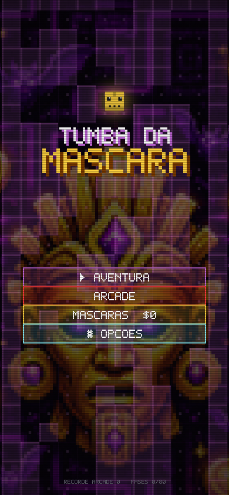
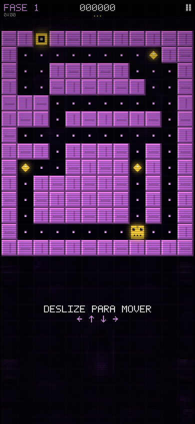
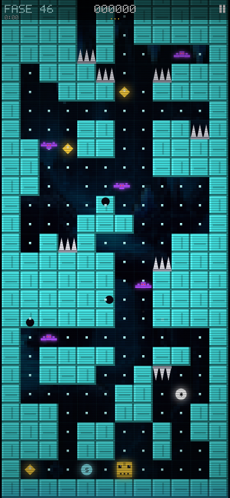
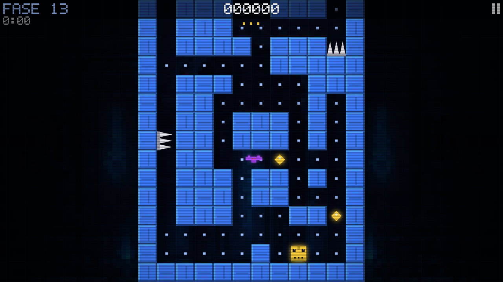

# Tumba da Máscara — jogo PWA de labirinto neon

Jogo próprio inspirado na mecânica de *Tomb of the Mask*: deslize e voe até bater na parede,
colete pontos e moedas, desvie de espinhos, morcegos, flechas e da lava que sobe.
Funciona no celular e no computador, instala como aplicativo e roda **offline**.

<div align="center">
    
  <br>
</div>

## Jogar

```bash
node server.js            # abre em http://localhost:8080 (e no IP da rede para o celular)
```

Sem instalar nada além do Node. Também há `Dockerfile` e um workflow de GitHub Pages
(`.github/workflows/pages.yml`) para publicar com HTTPS, necessário para instalar o PWA fora de localhost.

## Conteúdo

- 80 fases em 8 mundos (Catacumba, Cripta Azul, Selva Perdida, Vulcão, Abismo, Templo Dourado, Sombras, Núcleo), todas validadas por um solver: saída e coletáveis sempre alcançáveis e **nenhum beco sem saída** (de qualquer parada, a saída continua alcançável).
- Modo Arcade: coluna infinita para cima com espaço aberto, obstáculos e uma barreira piscante na cor do trecho que sobe em velocidade média. Encostou, perdeu.
- 3 estrelas por fase, loja de máscaras com bônus, power-ups (escudo, congelar, ímã).
- Música chiptune e efeitos sonoros gerados em tempo real (sem arquivos de áudio).
- **Modo Lúdico** (para crianças pequenas) e **Modo Clássico**, com a mesma dificuldade: o lúdico adiciona voz em português, elogios, confete e mensagens carinhosas; a seta de dica é opcional e vem desligada.
- Fonte pixel art própria, efeito CRT, tremor de tela, partículas.

Controles: deslizar na tela, ou setas / WASD no teclado. `P` pausa, `R` reinicia.

## Scripts

| Comando | O que faz |
|---|---|
| `npm start` | servidor estático na porta 8080 |
| `npm run build:levels` | regenera as 80 fases (`pwa/js/levels.js`) |
| `npm run validate` | verifica que todas as fases são solucionáveis |
| `node tools/process-assets.js` | converte as artes em `pwa/assets/src` em fundos e ícones |
| `npm run test:e2e` | teste de fumaça com Playwright (joga a fase 1 com o solver) |

Leia `ANALISE.md` para a análise completa do jogo original, decisões de design e questões legais.

## Versão antiga (Java)

Os arquivos `*.java`, o `.jar` e o `.exe` na raiz são o clone original em Java (projeto de faculdade)
que serviu de ponto de partida. A versão atual é a pasta `pwa/`.
